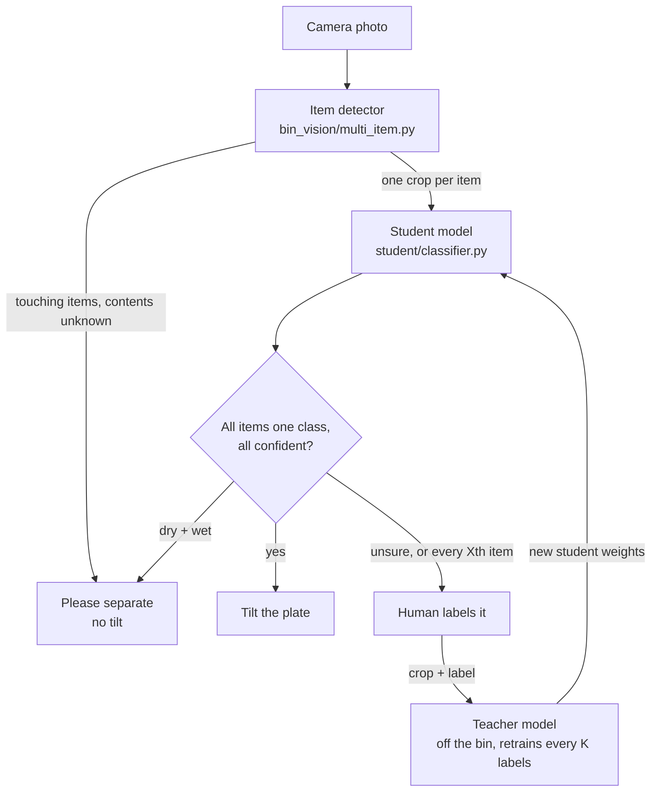

# ai-dustbin-data

Code and data for the AI dustbin: a bin that photographs what is put on its plate,
decides whether it is **wet** or **dry** waste, and tilts the plate into the right
compartment. A human is asked when the bin is unsure, and those answers are used to
improve the model over time.

| Folder | What it is | Owner |
|---|---|---|
| [`bin_vision/`](bin_vision/) | **Item detector**: finds, crops and counts the items on the plate, and makes the tilt decision | @Jhanviiigit |
| [`student/`](student/) | **Student model**: the small wet/dry classifier that runs on the bin | @siansusan |
| teacher | **Teacher model**: larger model, retrained from human feedback off the bin (not started) | Vibha |
| [`data_prep/`](data_prep/) | Dataset cleaning, balancing, background removal, packaging | @Jhanviiigit |
| [`reports/`](reports/) | Dataset reports per version | |

Nothing here comes from the original `ai_dustbin_2` code; only its images are reused.

## How the pieces fit together



1. The **camera** photographs the plate.
2. The **detector** compares the photo with a stored photo of the empty plate,
   finds each item, and cuts out **one crop per item**. It needs no neural network.
3. The **student** labels each crop **dry** or **wet**, with a calibrated confidence.
4. The **detector** combines the labels: the plate tilts only if every item belongs in
   the same compartment (dry, dry+dry, wet+wet...).
5. Unsure items (and a compulsory check every X items) go to a **human**. Their labels
   are sent to the **teacher**, which retrains and hands back a new student.

## The item detector (`bin_vision/`)

**What it does with each frame:**

| Step | How |
|---|---|
| Find what changed | Compares the frame with the empty-plate photo (colour difference, ignoring overall lighting changes and soft shadows) |
| Split into items | Cleans the change mask and splits it into blobs; pieces of one item lying close together are merged |
| Label items that end up touching | The **drop counter** watches the video: each time something lands and settles, it crops just the new region and labels it while the item is still alone |
| Spot merged items | A blob much bigger than one item, or with deep notches on both sides of a join, is probably several touching items |
| Decide | See below |

**Decisions** (`assess()` in `multi_item.py`):

| Decision | When | Bin should |
|---|---|---|
| `EMPTY` | nothing on the plate | wait |
| `TILT:DRY` / `TILT:WET` | every item confidently the same class | tilt |
| `MIXED` | confident items disagree (dry+wet) | not tilt; ask the user to separate |
| `ASK_HUMAN` | any item below the confidence threshold (0.6) | not tilt; ask a human |
| `SEPARATE` | a blob that looks like several touching items, with no drop history to label them | not tilt; ask the user to separate |

Every decision also records the load's **composition** (e.g. `dry+wet`) and its
**load confidence** (the lowest item confidence: a load is only as sure as its weakest item).

Run it on a webcam (press `r` with the plate empty, `q` to quit):

```bash
python bin_vision/multi_item.py --webcam                     # count-only mode, no model needed
python bin_vision/multi_item.py --webcam --student_dir student --model_path student/runs/organik/weights.pt
```

## How the detector plugs into the student

The two sides meet at **one function**. The detector never looks inside the model,
and the student never sees a whole photo.

```python
from classifier import WasteClassifier                      # student/classifier.py
student = WasteClassifier(model_path="student/runs/organik/weights.pt")
result = student.classify_image(crop_bgr)
# {"label": "dry" | "wet", "confidence": 0.0-1.0, "dry_prob": ..., "wet_prob": ..., "inference_ms": ...}
```

| | Agreed format |
|---|---|
| **Input** | One crop per item: numpy `uint8` H×W×3, **BGR** (OpenCV order) |
| **Framing** | The item's bounding box + **10% padding**, clamped to the frame |
| **Background** | Everything outside the item is **gray 128** (all channels), the same as dataset D. Training padding and augmentation fills must also be 128, never black |
| **Output** | `label` is `"dry"` or `"wet"`; `confidence` is calibrated (temperature scaling), so 0.8 means about 80% likely right |
| **Preprocessing** | Inside `classify_image()` (resize to 224, ImageNet normalisation), the same as in training |
| **Agreement logic** | In the detector only (`assess()`), not in the student |

The detector loads the student with `--student_dir student --model_path <weights>`
(module `classifier` by default) and also accepts `"dry waste"` / `"wet waste"` labels.

**Training matches the bin.** The student is trained and evaluated on item crops cut
the same way as the detector's: the Organik crops (release `data-organik-v2`) are already
cut to the item's box + 10% padding on gray 128. The student trains **only** on them; the
public datasets below (Roboflow, RealWaste) are the teacher's. See
[`student/README.md`](student/README.md).

## Results so far

All detector results are on **synthetic scenes**: real waste cutouts pasted onto fake
plates with lighting changes, noise and shadows. They will be re-run on photos from
the bin camera.

**Same compartment or not** (`bin_vision/test_composition.py`, 80 scenes per load). The
student is replaced by a stand-in that knows the true labels, to test the detector's
logic on its own:

| Load | Correct (perfect classifier) | Unsafe tilt (perfect) | Unsafe tilt (classifier 5% wrong + 5% unsure) |
|---|---|---|---|
| dry / wet | 91% / 95% | 0% | 6% / 4% |
| dry+dry, wet+wet apart | 100% | 0% | 0% |
| dry+wet apart | 91% | 8% | 18% |
| dry+dry touching, one by one | 99% | 0% | 1% |
| dry+wet touching, one by one | 95% | 4% | 10% |
| **dry+wet touching, dropped together** | 4% | **80%** | 76% |

- Loads are handled well when items lie apart or arrive one by one.
- Classifier mistakes add up across items, so calibrated confidence and the human
  threshold matter.
- **Touching dry+wet dropped together is the open case.** The bin should prompt "one
  item at a time"; a learned detector (e.g. YOLO) is future work.

More detail, including the item-count warning results, is in [`bin_vision/README.md`](bin_vision/README.md).

**Student:** trained on the Organik gray crops only (`organik_gray_v2`, release
`student-organik_gray_v2`). 5-fold cross-validation, grouped by image similarity: 96.75%
(std 1.4), AUC 0.994. Nothing has run on real bin photos yet. Details and download commands:
[`student/README.md`](student/README.md).

## Download the datasets

Use **v2**. It leaves out `dataset2`, whose origin could not be traced.
Datasets are attached to this repo's **Releases** as zip files, not committed to git.

| Dataset | What it is | Images (train / val / test) |
|---|---|---|
| `dataset_C_v2.zip` | Wet/dry **balanced 50/50 within each source**, original backgrounds | 2,772 (1,940 / 416 / 416) |
| `dataset_D_v2_balanced.zip` | **The same images as C v2, background removed** (U²-Net, gray 128) + masks. Compare this with C: only the background differs | 2,716 (1,902 / 403 / 411) |
| `dataset_D_v2.zip` | All cleaned images, background removed, **not balanced** (22% wet) + masks | 6,015 (4,214 / 898 / 903) |

These are the **teacher's** data. The **student** is trained on the Organik crops instead:
`gh release download data-organik-v2 --repo Jhanviiigit/ai-dustbin-data --pattern "dataset_organik_v2.zip"`
(see [`student/README.md`](student/README.md)). For the earlier public-data comparison runs
you need **`dataset_D_v2_balanced.zip` and `dataset_C_v2.zip`** (the masks for cropping are
in the D zip). Unzip both into the repo folder:

```bash
gh release download data-v2 --repo Jhanviiigit/ai-dustbin-data --pattern "dataset_D_v2_balanced.zip" --pattern "dataset_C_v2.zip"
```

The repo is private: you need to be added as a collaborator. Release `data-v1` is
superseded (it includes dataset2); keep it only for comparison.

Each zip has the same layout:

```
dataset_C_v2/
  train/  dry waste/  wet waste/
  val/    dry waste/  wet waste/
  test/   dry waste/  wet waste/
  masks/            (D zips only) one item mask per image, same folder structure
  manifest.csv      one row per image: source, original class, duplicate group, split
  report.md         counts per split and source
  DATA_LICENSE.txt  source credits and license
```

Images in the zips are shrunk to at most 512 px and saved as `.jpg`. In `manifest.csv`,
`new_path` is each file's path inside the dataset (with its original extension, so
match on the name without the extension); `path` is the file before cleaning.

**Never train or tune on `test/`.** Use `val/` for choosing epochs and settings.
`test/` is only for final numbers.

## How the data was built

Sources (v2):

| Source | Images | Notes |
|---|---|---|
| `roboflow` | 1,834 | Roboflow export in ai_dustbin_2 (includes TrashNet-style images). 29% wet. Some wet images carry stock-photo watermarks |
| `realwaste` | 4,257 used | [RealWaste](https://github.com/sam-single/realwaste) (Single et al., 2023), real waste photographed at a facility. Food Organics + Vegetation → wet; Cardboard, Glass, Metal, Paper, Plastic, Textile → dry; Miscellaneous Trash left out. 20% wet |
| ~~`dataset2`~~ | left out | Also in ai_dustbin_2. Origin unknown; it re-used Roboflow and RealWaste photos and some wet images carry stock-photo watermarks |

Pipeline (`data_prep/`):

1. **`clean_dataset.py`** → `cleaned_v2/` (6,089 images)
   - Tags every image with its source; `--exclude_sources dataset2` leaves dataset2 out.
   - Drops unreadable, tiny or blank images, and exact duplicates.
   - Groups near-duplicates (perceptual hash) and keeps each group inside a single split.
   - Splits 70/15/15, stratified by class **and** source.
   - Found that the original ai_dustbin_2 train/val split leaked (duplicates in both).
2. **`make_balanced.py`** → **dataset C**: downsamples dry so every source is 50/50 wet/dry
   in every split, so the source tells the model nothing about the class.
3. **`remove_background.py`** → **dataset D**: removes backgrounds with rembg (U²-Net,
   Qin et al., 2020), puts the object on flat gray 128, saves the masks, and drops images
   where the cutout erased the object. About 2.5 hours on a laptop CPU; `--reuse_from`
   reuses masks from an earlier run for identical images.
4. **`package_dataset.py`**: zips a dataset for release (resizes images, adds license credits).

To rebuild from scratch:

```bash
pip install -r requirements.txt
git clone https://github.com/siansusan/ai_dustbin_2.git
git clone https://github.com/sam-single/realwaste.git
python data_prep/clean_dataset.py --src ai_dustbin_2 --realwaste realwaste/RealWaste --exclude_sources dataset2 --out cleaned_v2
python data_prep/make_balanced.py --src cleaned_v2 --out dataset_C_v2
python data_prep/remove_background.py --src cleaned_v2 --out dataset_D_v2
python data_prep/remove_background.py --src dataset_C_v2 --out dataset_D_v2_balanced --reuse_from dataset_D_v2
```

Every step uses a fixed seed (42), so the same inputs give the same splits.
On Windows, clone with `git -c core.longpaths=true clone ...` if you hit "Filename too long".
The detector also needs OpenCV (`pip install opencv-python`).

Reports for each version are in `reports/v1/` and `reports/v2/`.

## Known issues and open questions

- **Touching dry+wet items dropped together** are tilted unsafely about 80% of the time
  on synthetic scenes. Prompt "one item at a time"; a learned detector is future work.
- **Gray vs plate background** for the student's crops: gray 128 is proposed (and is
  what the detector sends today). Both student variants can be trained and compared.
- **Few wet images.** Without dataset2, wet is 23% of the cleaned data (1,386 images), and
  dataset C has only 2,772 images.
- **Background removal fails on piles** (leaf heaps, stacks of pipes) and sometimes on
  transparent items. 74 images (1.2%) were dropped in D v2; Roboflow wet is highest at 5.2%.
- **No photos from the bin's own camera yet.** They are needed as the real test set and
  to re-tune the detector's "bigger than one item" size threshold.
- **Teacher model and human-in-the-loop** are designed but not built.

## License

The data comes from third parties (see `DATA_LICENSE.txt` in each zip). RealWaste is
**CC BY-NC-SA 4.0**, so the combined datasets are non-commercial and must be shared
under the same license.
