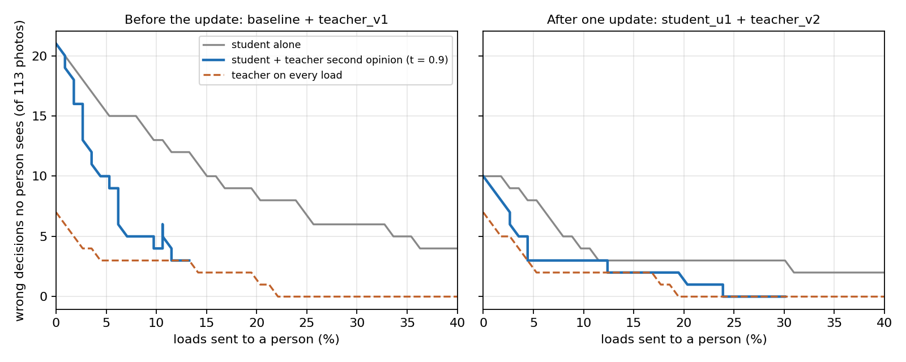

# The teacher as a second opinion (session 1 only)

**At the same share of loads sent to a person, a student that asks the teacher before asking a person lets
fewer wrong decisions through than the student alone.** Before the update the difference is large and
significant per photo (11 vs 17 wrong decisions at 3.5% of loads asked, p 0.031); after one update it is smaller
and not significant. Running the teacher on every load is better still. All of this is offline, on session 1
images only; session 2 (2 Nov) was not used and stays the confirmation set.

## Why this test

The earlier claim "distillation from the teacher halves human requests (19% to 9%)" did not survive: the gap
came from the two students' temperatures (fitted on a 75-image val with one error each), and at an equal
share sent to a person the two students left the same number of errors. This tests a different use of the
teacher, where calibration cannot decide the result.

## The policies (one photo = one load)

| | Policy | Who decides an unsure load |
|---|---|---|
| a | student alone (today) | student confidence < 0.8 -> a person |
| b | **student + teacher second opinion** | student < 0.8 -> teacher; teacher confidence >= t -> the teacher's label; otherwise a person |
| c | student alone, made stricter | the k least-confident student loads -> a person, with k = as many as b asks (matched) |
| d | teacher on every load | teacher confidence < 0.8 -> a person (reference: "why not just the teacher?") |

Offline: saved session 1 photos replayed through the models and the decision rules on a laptop; the
"person" answers with the true label; the 1-in-10 audits are left out of every policy.

## Data and models (session 1 only)

| Set | Photos / items | Used for |
|---|---|---|
| Loop pile | 121 / 56 | choosing the teacher threshold t (pair 1: all of it; pair 2: the 65 photos / 31 items with no photo in the update's feedback) |
| Test pile | 113 / 58 | the result, scored once with t fixed |

| Pair | Student | Teacher | Saw the loop pile? |
|---|---|---|---|
| 1 (before any update) | `organik_gray_v2` | `teacher_v1_gray` | no |
| 2 (after one update) | `student_u1` | `teacher_v2` | 25 loop items were in the update's feedback: excluded from choosing t |

## How t was chosen (rule fixed before scoring the test pile)

From 0.80, 0.85, 0.90, 0.95, 0.99: the lowest value at which the teacher's calls on unsure loads in the
loop pile have no errors; if none, 0.99. 0.95 is reported as well (suggested earlier).

| Pair | Unsure loop loads | Teacher calls / wrong at 0.80, 0.85, 0.90, 0.95, 0.99 | t |
|---|---|---|---|
| 1 | 26 | 23/2, 23/2, **21/0**, 19/0, 17/0 | **0.90** |
| 2 | 3 | 1/1 at every value | **0.99** (fallback: only 3 unsure loads, too few to choose) |

## Results on the test pile, per photo (113)

| Pair, t | Policy | Sent to a person [95% CI] | Wrong decisions nobody sees | Teacher calls / wrong |
|---|---|---|---|---|
| 1, 0.90 | a student alone | 15.9% [10.3, 23.8] | 10 | |
| | **b + teacher** | **3.5% [1.4, 8.7]** | **11** | 14 / 1 |
| | c student, matched | 3.5% | 17 | |
| | d teacher alone | 8.0% | 3 | |
| 1, 0.95 | b + teacher | 6.2% [3.0, 12.2] | 10 | 11 / 0 |
| | c student, matched | 6.2% | 15 | |
| 2, 0.99 | a student alone | 8.8% [4.9, 15.5] | 5 | |
| | **b + teacher** | **4.4% [1.9, 9.9]** | **5** | 5 / 0 |
| | c student, matched | 4.4% | 8 | |
| | d teacher alone | 7.1% | 2 | |
| 2, 0.95 | b + teacher | 1.8% [0.5, 6.2] | 5 | 8 / 0 |
| | c student, matched | 1.8% | 10 | |

Paired tests on "wrong decision nobody sees" (exact McNemar):

| Pair, t | b vs a | b vs c (same share asked) |
|---|---|---|
| 1, 0.90 | b wrong alone 1, a wrong alone 0, p 1.0 | b 0, c 6, **p 0.031** |
| 1, 0.95 | 0 vs 0, p 1.0 | b 0, c 5, p 0.062 |
| 2, 0.99 | 0 vs 0, p 1.0 | b 0, c 3, p 0.25 |
| 2, 0.95 | 0 vs 0, p 1.0 | b 0, c 5, p 0.062 |

So against today's rule (a), the teacher cuts the share asked by half to three-quarters for 0 or 1 extra
error; against simply asking people less (c), it lets 3-6 fewer errors through.

## Calibration cannot explain it

1. **Matched comparison (b vs c).** Both ask exactly the same number of loads, and which loads are least
   confident does not depend on the student's temperature.
2. **"Unsure" by share instead of 0.8.** With unsure = the 10 / 15 / 20 / 25% least-confident student loads
   (t fixed as chosen), the second opinion leaves fewer errors than the student alone at the same share asked
   at every level:

   | Unsure share | Pair 1: b / c errors left (asked) | Pair 2: b / c errors left (asked) |
   |---|---|---|
   | 10% | 14 / 18 (3) | 4 / 8 (5) |
   | 15% | 11 / 17 (4) | 3 / 8 (6) |
   | 20% | 9 / 15 (6) | 3 / 5 (9) |
   | 25% | 8 / 15 (7) | 3 / 4 (11) |

3. **The teacher's t is chosen on held-out photos for that same teacher,** so its temperature only renames the
   threshold.
4. **The whole curve** (no threshold at all): `cascade_curves.png`.

The only numbers that depend on calibration are the policy-a and policy-b shares at 0.8, which describe
the deployed rule as it is.

## Per item (58)

The direction is the same but the differences are 0-1 items, so nothing is significant per item:
pair 1 at 0.90, a 19.0% asked / 5 errors left, b 8.6% / 5, c 8.6% / 6, d 10.3% / 0; pair 2 at 0.99,
a 10.3% / 2, b 6.9% / 2, c 6.9% / 3, d 8.6% / 1 (all in `cascade_report.json`).

## What this means

- **Supported (session 1, per photo):** the teacher as a second opinion lets a person be asked about far
  fewer loads, for no or one extra error, and beats simply asking people less at the same effort. The
  benefit is largest when the student is weakest (before the update).
- **Not supported yet:** a significant effect per item, or after the update; pair 2's t could not be chosen
  properly (3 unsure loads to choose from).
- **The teacher on every load is the most accurate policy** (pair 1: 3 errors left at 8% asked vs the second
  opinion's 11 at 3.5%). The second opinion's case is cost: the teacher runs only on the student's unsure
  loads (16% before the update, 9% after), at about 0.38 s per crop on a laptop CPU against 0.035 s for the
  student. Loads the student gets wrong with high confidence never reach the teacher; that is where the
  remaining errors are.
- **Session 2 is the test:** t fixed at 0.90 (from pair 1) and 0.99 (pair 2) before the wet photos are scored.

## Caveats

- I had already printed second-opinion numbers on this test pile before this rule was set; t comes from the
  loop pile, but this is exploratory until session 2 confirms it.
- Small numbers: 14 teacher calls on the test pile for pair 1, 5 for pair 2.
- Offline replay; the person never errs; one session, one plate, one light.
- Side finding: re-saving a crop as JPEG (quality 95) flipped the baseline student's label on 4 of 121 loop
  loads compared with the in-memory crop the bin classified.

## Files

| File | What |
|---|---|
| `cascade.py` | the analysis (`python experiments/camera_day_2026-10-30/cascade/cascade.py`) |
| `curves.py` | the figure |
| `cascade_report.json` | every number above, per photo and per item, plus the curves |
| `cascade_curves.png` | wrong decisions nobody sees against share sent to a person |
| `loop_items_used.txt` | loop items with a photo in the update's feedback (left out of pair 2's choice of t) |
| `predictions/` | each model's prediction for every loop and test photo |

On a checkout in a very long Windows path, run it from a shorter folder (Windows' 260-character limit).
