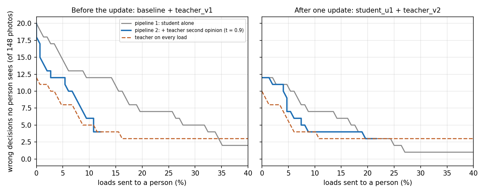

# Pipeline 2 (the teacher as a second opinion) on session 2

The same test that was run on the 30 Oct photos (branch `results/teacher-second-opinion`, folder
`experiments/camera_day_2026-10-30/cascade/`), now on the 50 new items of session 2. Offline, from the saved
predictions in [`../results/predictions`](../results/predictions); nothing is trained or tuned on session 2.

**At the same number of loads sent to a person, pipeline 2 lets 3-5 fewer wrong decisions through per photo, on
both pairs. Per item there is no difference.**

## The two pipelines

| Name here | Policy in the 30 Oct write-up | Who decides an unsure load |
|---|---|---|
| **Pipeline 1** (the bin today) | a | student confidence < 0.8 -> a person |
| **Pipeline 2** | b | student < 0.8 -> the teacher; teacher confidence >= t -> the teacher's label, otherwise a person |
| | c | pipeline 1 made stricter: the k least-confident student loads -> a person, k = as many as pipeline 2 asks (matched) |
| | d | teacher on every load: teacher confidence < 0.8 -> a person (reference) |

One photo is one load; the 1-in-10 audits are left out of every policy; the "person" answers with the true label.
The policy functions are copied unchanged from the 30 Oct `cascade.py`.

**The teacher threshold t is fixed from session 1**, as that write-up set it before session 2 was scored: 0.90 for
pair 1 (`organik_gray_v2` + `teacher_v1_gray`), 0.99 for pair 2 (`student_u1` + `teacher_v2`); 0.95 is reported as
well. No value was chosen on session 2.

## Results at the deployed threshold (0.8), per photo (148)

| Pair, t | Policy | Sent to a person [95% CI] | Wrong decisions nobody sees | Teacher calls / wrong |
|---|---|---|---|---|
| 1, 0.90 | pipeline 1 | 10.8% [6.8, 16.8] | 12 | |
| | **pipeline 2** | **3.4% [1.5, 7.7]** | **12** | 11 / 0 |
| | c: pipeline 1, matched | 3.4% | 17 | |
| | d: teacher on every load | 10.1% | 5 | |
| 1, 0.95 | pipeline 2 | 4.1% [1.9, 8.6] | 12 | 10 / 0 |
| | c: matched | 4.1% | 16 | |
| 2, 0.99 | pipeline 1 | 6.8% [3.7, 12.0] | 9 | |
| | **pipeline 2** | **4.7% [2.3, 9.4]** | **9** | 3 / 0 |
| | c: matched | 4.7% | 11 | |
| | d: teacher on every load | 9.5% | 4 | |
| 2, 0.95 | pipeline 2 | 4.1% [1.9, 8.6] | 9 | 4 / 0 |
| | c: matched | 4.1% | 11 | |

Paired tests on "wrong decision nobody sees" (exact McNemar), per photo:

| Pair, t | pipeline 2 vs pipeline 1 | pipeline 2 vs c (same share asked) |
|---|---|---|
| 1, 0.90 | 0 vs 0, p 1.0 | 0 vs 5, p 0.062 |
| 1, 0.95 | 0 vs 0, p 1.0 | 0 vs 4, p 0.125 |
| 2, 0.99 | 0 vs 0, p 1.0 | 0 vs 2, p 0.5 |
| 2, 0.95 | 0 vs 0, p 1.0 | 0 vs 2, p 0.5 |

## Without any threshold: "unsure" by share (calibration cannot decide this)

"Unsure" = the q least-confident student loads (t fixed as above). Pipeline 2 asks fewer loads than were unsure,
because the teacher decides some of them. Wrong decisions nobody sees, per photo (148):

| Unsure share | Pair 1: pipeline 2 errors (asked) | Pair 1: pipeline 1 at the same asked | Pair 2: pipeline 2 errors (asked) | Pair 2: pipeline 1 at the same asked |
|---|---|---|---|---|
| 10% | 12 (4) | 17 | 7 (8) | 10 |
| 15% | 11 (8) | 14 | 6 (10) | 9 |
| 20% | 10 (9) | 13 | 4 (13) | 7 |
| 25% | 10 (10) | 13 | 4 (16) | 7 |

The teacher makes wrong calls once it is given more loads: pair 1 3 of 21 and 3 of 27 (at 20% and 25% unsure),
pair 2 1 of 17 and 2 of 21. The whole curve is `cascade_curves.png`.

## Per item (50)

The differences are 0-1 items, so nothing is significant. At 0.8: pair 1 pipeline 1 asks 18.0% (9 items) and leaves
3, pipeline 2 asks 12.0% (6) and leaves 3, matched 3, teacher on every load 1. Pair 2 pipeline 1 asks 16.0% (8)
and leaves 1, pipeline 2 asks 8.0% (4) and leaves 1, matched 2 (p 1.0), teacher on every load 1. By share, pipeline 2
leaves the same number as pipeline 1 at every level for pair 1 and one fewer for pair 2 at 15-25%.

## What this means

- Session 2 repeats the direction of 30 Oct: for the same human effort, the teacher as a second opinion lets
  fewer wrong decisions through per photo. The 30 Oct pair 1 result was p 0.031; here it is p 0.062.
- The same errors are left as with pipeline 1 while fewer loads go to a person; the teacher was right on every
  call it made at the fixed t (11, 10, 4 and 3 calls).
- The wrong decisions nobody sees are the student's confident errors; the second opinion does not reach them.
  The teacher on every load leaves the fewest (5 and 4), so pipeline 2 is a cheaper compromise, not the most
  accurate policy.
- It puts the teacher in the live path for the student's unsure loads (about 7-11% of loads here). The teacher
  step is offline in pipeline 1. The 30 Oct write-up measured about 0.38 s per crop on a laptop CPU against 0.035 s
  for the student; that was not re-measured here.

## Limits

- Few teacher calls (3-27), so differences of one or two decisions are noise.
- Offline replay on saved predictions; the person never errs; one session, one plate, one light; the teacher was
  not run on the bin.
- The models' session 2 accuracies had been scored before this run; t came from session 1 and was not changed.

## Files

| File | What |
|---|---|
| `cascade.py` | the analysis: `python experiments/session2_2026-11-02/cascade/cascade.py` from the repo root |
| `cascade_report.json` | every number above, per photo and per item, plus the curves |
| `cascade_curves.png` | wrong decisions nobody sees against share sent to a person |
